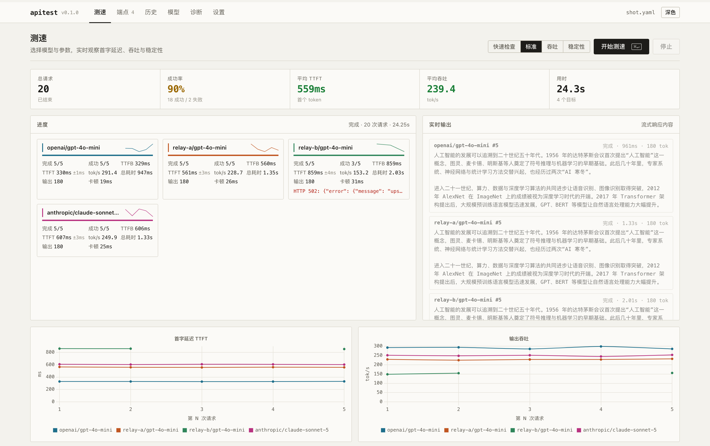
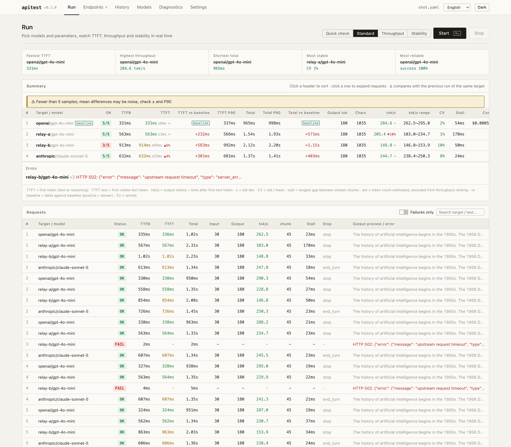

<div align="center">


# apitest

**Latency & throughput benchmark for AI APIs** — TTFT, tokens/s, stability and gateway overhead, for any OpenAI-compatible / Anthropic / Gemini endpoint

[](https://www.python.org/)
[](LICENSE)
[](https://github.com/liningbest/apitest/actions)

[中文文档](README.md)

</div>

---

How much latency does a relay add over calling the provider directly? Which gateway has the faster first token, and which one degrades at night? `apitest` turns "it feels slow" into a reproducible report: it sends real streaming requests to any OpenAI-compatible, Anthropic or Gemini endpoint, measures **TTFT, throughput, total time, success rate and stalls**, aggregates over multiple rounds with percentiles and variance, ranks the targets, and keeps every run in a local history.

<p align="center"></p>

## Features

- **One methodology across providers** — OpenAI-compatible (incl. relays such as one-api / new-api, OpenRouter, DeepSeek), Anthropic Messages, Google Gemini; streaming and non-streaming.
- **Accurate metrics** — TTFB, TTFT, first *visible text* token, total time, output tok/s, longest stream stall, reasoning tokens, stop reason (truncated by `max_tokens` or not). Throughput uses the time after the first text token, so gateways that do or don't forward thinking deltas are comparable.
- **Statistics, not single samples** — mean / P50 / P90 / P99 / min / max / std / CV; automatic warnings when the comparison is not trustworthy (too few samples, output length mismatch, estimated tokens).
- **Experiment design built in** — targets are interleaved round-robin by default to cancel time drift; mark a direct-to-provider target as *baseline* and get each gateway's overhead; estimated-token targets are excluded from throughput ranking.
- **Load modes** — rounds, concurrency, duration-based soak, warmup, retries, interval; Ctrl+C keeps what has completed.
- **Local web UI** — endpoint management (fetch model list, test connection, one-click quick test), live curves and streaming output, ranking, sortable summary, per-request details, history with comparison and trend charts, connectivity diagnostics, light/dark theme.
- **Keep records** — history includes per-request details; export JSON / CSV / Markdown; `--json` for scripting.
- **Connectivity diagnostics** — DNS / TCP / TLS / HTTP phase timing with its own history, to separate network from model latency.

## Install

Python 3.9+. With [uv](https://github.com/astral-sh/uv):

```bash
git clone https://github.com/liningbest/apitest.git
cd apitest
uv sync
uv run apitest --help
```

or `pip install -e .`. Below, `apitest` stands for `uv run apitest`.

## Quick start

```bash
# one endpoint, no config
apitest run --url https://api.openai.com/v1 --key sk-xxx -m gpt-4o-mini -n 5

# several models on one endpoint
apitest run --url https://api.example.com/v1 --key sk-xxx -m gpt-4o-mini,deepseek-chat -n 5 --sort tps

# config file for long-term comparisons
apitest init          # writes ./apitest.yaml
apitest run --all
```

```yaml
# apitest.yaml
defaults:
  rounds: 5
  max_tokens: 512
endpoints:
  openai:
    base_url: https://api.openai.com/v1
    api_key: ${OPENAI_API_KEY}
    models: [gpt-4o-mini, gpt-4o]
    price: { gpt-4o-mini: [0.15, 0.60] }   # USD per 1M tokens [input, output], optional
  claude:
    provider: anthropic
    base_url: https://api.anthropic.com
    api_key: ${ANTHROPIC_API_KEY}
    models: [claude-sonnet-5]
  relay:
    base_url: https://api.some-relay.com/v1
    api_key: sk-xxx
    models: [gpt-4o-mini]
    headers: { X-Custom: value }
```

Gateway overhead in one command:

```bash
apitest run -e openai -e relay -m gpt-4o-mini -n 10 --baseline openai/gpt-4o-mini --export compare.md
```

## Web UI

```bash
apitest web            # opens http://127.0.0.1:8787
```

<p align="center"></p>

Pages: **Run** (scenario presets, live KPIs, per-target cards, streaming output, TTFT / throughput charts, ranking, sortable summary with Δ vs. last run and baseline deltas, details, export), **Endpoints** (auto-saved to `apitest.yaml`, fetch models, test connection, quick test), **History** (full report of any past run, compare two runs, per-target trend), **Models**, **Diagnostics** (DNS / TCP / TLS / HTTP with history), **Settings**. The server binds to `127.0.0.1` only; keys never leave your machine.

## Metrics

| Metric | Meaning |
|---|---|
| **TTFB** | Request sent → HTTP headers received (handshake + first byte) |
| **TTFT** | Request sent → first token (text or reasoning delta) |
| **TTFT text** | Request sent → first visible text token |
| **Total** | Request sent → end of stream |
| **tok/s** | Output tokens ÷ (total − TTFT text) |
| **±** | Standard deviation; with fewer than 5 samples trust ± and P90, not the mean |
| **CV** | std / mean, lower is more stable |
| **Stall** | Longest gap between consecutive stream chunks |
| **Truncated** | Runs whose stop reason was `length` / `max_tokens` |
| **est** | Token counts estimated from characters (no `usage` in response); excluded from throughput ranking |
| **vs baseline** | Delta against the baseline target; positive = slower |

## Making comparisons trustworthy

1. **Interleave** (default): round 1 hits A, B, C once each, then round 2… `--order sequential` or `--order parallel` when you really want them.
2. **Baseline**: `--baseline endpoint/model` reports each gateway's TTFT / total-time overhead.
3. **Fix the request**: same preset, same `max_tokens`, optionally `--temperature 0`. Output length and a text hash are recorded; a >30 % length spread is flagged.
4. **Look at the distribution**: at least 5 rounds, read P90 / ± / CV; for stability use `--duration 60 -c 4`.
5. **Diagnose first**: `apitest ping` shows how much of 800 ms is TLS.

## Try it without a key

```bash
python tests/mock_server.py 8765 &
apitest run --url http://127.0.0.1:8765/v1 -m mock-fast,mock-slow -n 3 --no-history
```

## Project layout

```
apitest/
├── providers.py   request builders + SSE parsers for the three API styles
├── runner.py      async execution: timing, concurrency, interleaving, soak
├── metrics.py     percentiles, stability, baseline deltas, comparability notes
├── report.py      terminal tables, JSON / CSV / Markdown export
├── history.py     run & ping history (JSONL)
├── netcheck.py    DNS / TCP / TLS / HTTP phase timing
├── web.py         Starlette backend with SSE
├── static/        single-file frontend, no build step
└── cli.py         CLI entry point
tests/mock_server.py   mock server for all three API styles
```

## License

[MIT](LICENSE)
